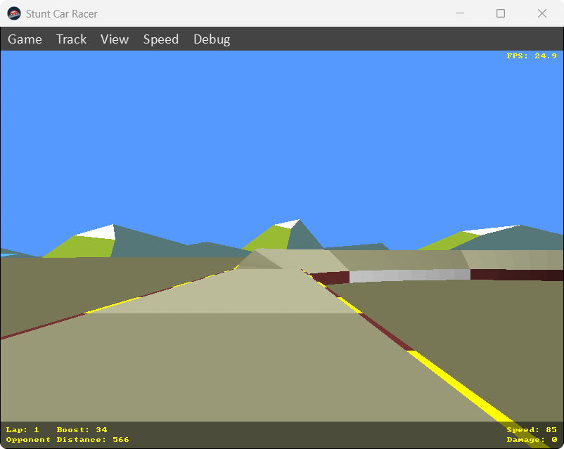

# Stunt Car Racer

[](https://github.com/ZacWalk/stuntcarracer/actions/workflows/build.yml)

A Windows C++ port of Geoff Crammond's 1989 elevated-track racing game, based on
[stuntcarremake](http://sourceforge.net/projects/stuntcarremake/). Two cars race
head-to-head over ramps and broken bridges; the track is the obstacle.



## How it works

The game keeps its own 3D pipeline but draws the result with
[libdesktop](https://github.com/ZacWalk/libdesktop)'s 2D polygons.
[src/render.scene.cpp](src/render.scene.cpp) lights, clips and projects each
face, then paints the frame's faces from far to near — the painter's algorithm —
over the backdrop and under the HUD. Stretches of track, cars and their parts
each have ordering rules that keep the original's look; the renderer's comments
explain them.

The game runs in a libdesktop `ui::shell`, which steps it at the Amiga's 25
steps a second and redraws it after each step, with Direct3D where it works.
Audio uses `platform::sound_buffer`; without a usable audio device the game runs
silent and its title says "(no sound)".

All game data — tracks, sounds and textures — is compiled into the executable.

## Playing

Arrow keys drive, <kbd>Ctrl</kbd>+<kbd>Up</kbd> is boost, <kbd>Space</kbd>
toggles the camera. In the track menu, <kbd>1</kbd>–<kbd>8</kbd> pick one of the
eight tracks; <kbd>S</kbd> previews it and starts the race on a second press.
<kbd>Esc</kbd> returns to the track menu, <kbd>P</kbd>/<kbd>O</kbd> pause and
resume, <kbd>R</kbd> turns the car round and <kbd>Z</kbd> restarts the race.
<kbd>F5</kbd> shows statistics and <kbd>F9</kbd>/<kbd>F10</kbd> change game
speed.

## Known differences

- **No game-over state.** The original ended the game six seconds after the
  finish: the cars stopped, the engine fell silent and it showed *GAME OVER:
  Press 'M' for track menu*. This port never enters that state, so the *RACE
  WON* or *RACE LOST* banner keeps flashing and the race carries on until
  <kbd>Esc</kbd> returns to the track menu or <kbd>Z</kbd> restarts it.
  `GAME_OVER` is declared and handled in `src/game.cpp`, but nothing sets it.

## Building

Requires Windows x64 and Visual Studio with the Desktop C++ workload. The
vendored [dd](https://github.com/ZacWalk/dd) runtime locates Visual Studio and
uses the CMake and Ninja that ship with it.

```powershell
.\dd.ps1 build                       # both configurations
.\dd.ps1 test --label stuntcarracer  # the headless self-tests
.\dd.ps1 test --label headless      # common no-visible-UI gate, both configurations
```

Output is `exe\stunt-car-racer-64.exe` (`stunt-car-racer-64d.exe` for Debug).
libdesktop is fetched at its pinned revision, or taken from a sibling
`../libdesktop` checkout when present.

The self-tests are the game's own `-test` mode: physics on every track, menus,
pausing, window presentation and the scene's drawing order, checked without
opening a window. An unfiltered `.\dd.ps1 test` also opens the game's window
briefly.

Both labels print the self-test's actual check/failure counts; the build-only
smoke is identified separately. After building, rerun with
`ctest --preset debug -L headless -V --no-tests=error` (or `release`).
For a direct GUI-executable test, pipe both streams so PowerShell waits:
`& .\exe\stunt-car-racer-64.exe -test 2>&1 | Out-Host; $LASTEXITCODE`.

### Icon

`python tools\generate_icon.py` regenerates `src\res\stuntcarracer.ico`
from the car and elevated-track vectors, in nine desktop sizes. Add `--check`
to verify without writing, or `--output tmp\icon-128.png --size 128` for another
size. Python 3.9+'s standard library and the vendored `tools\iconlib.py` are
sufficient; no screenshot, sibling checkout or graphics package is required.

## Documentation

[AGENTS.md](AGENTS.md) — conventions for contributors and coding agents.

## Licence

No licence is granted for this repository; see [NOTICE](NOTICE). The
executable includes [libdesktop](https://github.com/ZacWalk/libdesktop), which
is licensed under the Mozilla Public License 2.0, and `tools/iconlib.py` is
vendored from libdesktop under the same licence.

Before any binary distribution, first obtain the rights needed to distribute
the game: libdesktop's licence grants no rights to the game's code or assets.
A binary distribution must also tell its recipients where to get libdesktop's
source code, including any changes made to it.
