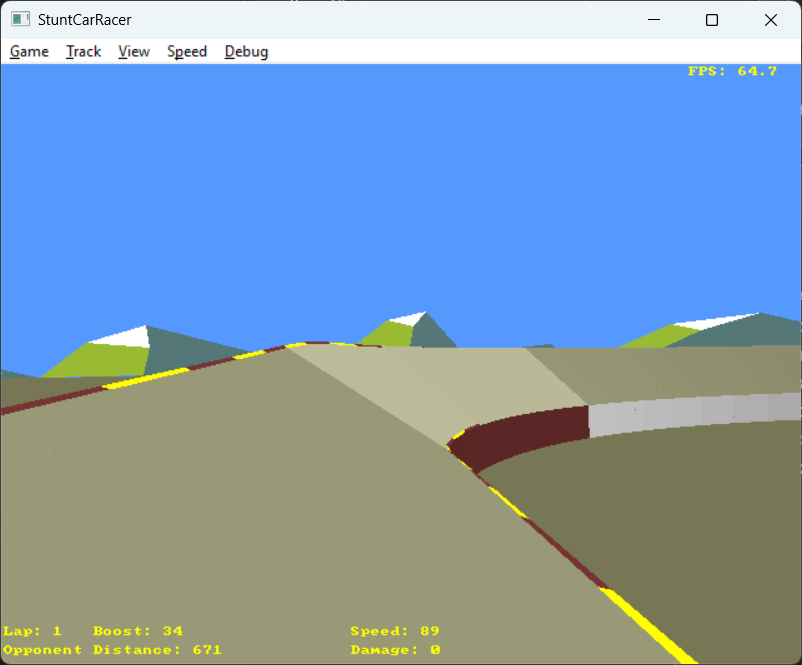

# Stunt Car Racer

[](https://github.com/ZacWalk/stuntcarracer/actions/workflows/build.yml)

A Windows C++ port of Geoff Crammond's 1989 elevated-track racing game, based on
[stuntcarremake](http://sourceforge.net/projects/stuntcarremake/). Two cars race
head-to-head over ramps and broken bridges; the track is the obstacle.

I used to love this game when I was a kid.



## How it works

Everything on screen comes from a **software 3D renderer** in
[src/render.software.cpp](src/render.software.cpp) — no Direct3D, OpenGL or GPU
acceleration:

- 4×4 matrix pipeline (world / view / perspective), near-plane clipping in
  homogeneous space
- Edge-function rasterizer with perspective-correct interpolation via 1/w
- Z-buffer depth testing; both windings drawn, since the single-sided track
  vanished under back-face culling whenever the eye dipped below the road; flat
  shading with one directional light
- Affine 2D primitives for the HUD and text

The finished RGBA framebuffer is blitted to the window by the platform layer's
`present_pixels`, outside any paint handler, so the game keeps control of its
frame loop. Audio is XAudio2 through `pf::sound_buffer`; without a usable audio
device the game runs silent and its title says "(no sound)".

All game data — tracks, sounds and textures — is compiled into the executable.

## Playing

Arrow keys drive, <kbd>Ctrl</kbd>+<kbd>Up</kbd> is boost, <kbd>Space</kbd>
toggles the camera. In the track menu, <kbd>1</kbd>–<kbd>8</kbd> pick one of the
eight tracks and <kbd>S</kbd> starts the race. <kbd>Esc</kbd> returns to the
track menu, <kbd>P</kbd>/<kbd>O</kbd> pause and resume, <kbd>R</kbd> turns the
car round and <kbd>Z</kbd> restarts the race. <kbd>F5</kbd> shows statistics and
<kbd>F9</kbd>/<kbd>F10</kbd> change game speed.

## Known differences

- **No game-over state.** The original ended the game six seconds after the
  finish: the cars stopped, the engine fell silent and it showed *GAME OVER:
  Press 'M' for track menu*. This port never enters that state, so the *RACE
  WON* or *RACE LOST* banner keeps flashing and the race carries on until
  <kbd>Esc</kbd> returns to the track menu or <kbd>Z</kbd> restarts it.
  `GAME_OVER` is still declared and handled in `src/game.cpp`; nothing sets it.

## Building

Requires Windows x64 and Visual Studio with the Desktop C++ workload. The
vendored [dd](https://github.com/ZacWalk/dd) runtime locates Visual Studio and
uses the CMake and Ninja that ship with it.

```powershell
.\dd.ps1 build        # both configurations
.\dd.ps1 test         # build and run the suite
```

Output is `exe\stunt-car-racer-64.exe`. The platform layer comes from
[libdesktop](https://github.com/ZacWalk/libdesktop) via
`FetchContent`; a sibling `../libdesktop` checkout is used automatically when
present.

## Documentation

[AGENTS.md](AGENTS.md) — conventions for contributors and coding agents.

## Licence

No licence is granted for this repository; see [NOTICE](NOTICE). The
executable links libdesktop (LGPL-2.1-or-later) statically, so a distributed
binary must let its users relink it against a modified libdesktop (LGPL-2.1
section 6).

Before any binary distribution, first obtain the rights needed to distribute
the game. The libdesktop licence does not grant rights to the game's code or
assets. Include libdesktop's notices, licence and corresponding source,
including changes, plus legally distributable application source and build
instructions or relinkable object files. Record the exact revisions,
compiler and configuration, and verify a build with a modified libdesktop.
Recipients must be permitted to modify it for their own use and reverse
engineer it to debug those modifications. This notice alone does not make a
binary distribution compliant.
